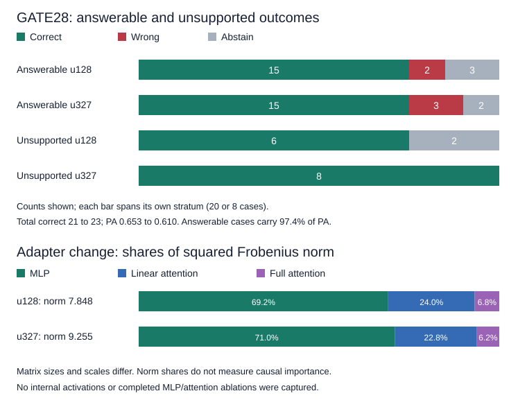

# FT2 overnight results and weight-analysis preview

Completed 2026-11-08. **Training finished all 327 updates. Update 128 was selected; the frozen promotion rule returned `RETAIN_FT1`.** This report describes an inspected development evaluation, not a fresh competition benchmark or official leaderboard result.

This page shares aggregate measurements. Competition questions, answers, business data, raw SQL/generation traces, adapters and resumable states remain private.

## Run and evaluation setup

- Model family: Qwen3.5-9B; LoRA rank 16, alpha 32, 248 adapted modules.
- One Colab G4 / NVIDIA RTX PRO 6000 Blackwell Server Edition.
- Training with thinking enabled; matched stock-on and FT2-on evaluation arms.
- Serving route: verified rounded BF16 merge, loaded into a clean vLLM server. GPU prefix caching was disabled after repeat-jitter diagnostics. Runtime LoRA was not the accepted evaluation route.
- Context 32,768; up to 8,192 new tokens per turn, eight SQL calls and 12 turns; temperature 0, seed 47.
- Startup checks passed through the accepted route: longest-example fit, bit-identical state swap, 248-module topology/route checks and measured startup timing. The initial CPU sweep selected 22 threads; later investigation invalidated its cache-parity conclusion, as detailed below.
- Startup mean: 64.9 seconds/update, p95 92.4. Recorded optimizer-update durations totaled 5.91 hours; driver start to closeout was 7.47 hours. Earlier unsuccessful launch attempts are excluded from those durations.
- Screens at updates 64, 128 and 327 returned `CONTINUE`; final exports completed without reported export errors. The Colab runtime was deleted after artifact verification.

The run used the reference PyTorch causal-convolution implementation. A compatible `causal-conv1d` build is a future benchmark candidate; no accelerated-kernel speedup was measured.

## Final results

`C/W/A` means correct / wrong / abstain. FTE80 has 60 answerable and 20 unsupported cases.

| FTE80 arm | Raw PA | Answerable C/W/A | Unsupported C/W/A | Total correct |
|---|---:|---:|---:|---:|
| Matched stock, thinking on | -0.1753 | 21 / 33 / 6 | 17 / 2 / 1 | 38 / 80 |
| FT2 update 128, thinking on | +0.6351 | 45 / 7 / 8 | 16 / 2 / 2 | 61 / 80 |
| Historical FT1 update 128, thinking off | +0.5013 | 44 / 14 / 2 | 15 / 4 / 1 | 59 / 80 |

The historical FT1 runtime provenance is unmatched. Its comparison is exploratory and does not isolate training-recipe effects. FT2 versus matched stock had 27 newly correct cases, four previously correct cases lost and 34 retained correct cases.

### Why FT2 was not promoted

FTE75 reuses the FTE80 predictions after excluding five cases whose normalized question wording overlapped historical training. It has 55 answerable and 20 unsupported cases; it requires no additional inference. Identified matching training episodes were excluded from FT2 training. Both full and filtered views remain inspected development sets, with shared training businesses and no claim of untouched generalization.

| View | FT2 raw PA | Historical FT1 raw PA | FT2 gains / losses versus historical FT1 |
|---|---:|---:|---:|
| FTE80 | +0.6351 | +0.5013 | 9 / 7 |
| FTE75 | +0.6026 | +0.5279 | 7 / 7 |

Promotion required higher PA and strictly more paired gains than losses on **both** views, alongside the stock/safety/artifact conditions. The FTE75 gain/loss tie failed that requirement. This is a policy verdict, not a claim that FT2 had lower PA.

For these reported flips, a gain changes a previously non-correct case to correct; a loss changes a previously correct case to non-correct. PA also accounts for wrong versus abstain and weights the two gold strata differently:

```text
case score = +1 correct, -1 wrong, 0 abstain
PA = 0.974 * mean(answerable case scores)
   + 0.026 * mean(unsupported case scores)
```

Equal gain/loss counts can therefore coexist with different PA.

## Why update 128 was selected

The final selection compared updates 128 and 327 on GATE26, the overlap-excluded version of the 28-case screen. PA was +0.615 at update 128 versus +0.567 at update 327. This establishes the better of those evaluated candidates under the selection rule; update 327 did not receive a full FTE80 run.



On GATE28, total correct increased from 21 to 23 between updates 128 and 327. Answerable outcomes changed from **15/2/3 to 15/3/2**, while unsupported outcomes improved from **6/0/2 to 8/0/0**. The heavily weighted extra answerable error outweighed the unsupported improvements: PA changed by -0.0487 + 0.0065 = **-0.0422**. This is an observed tradeoff; these small screens do not establish overfitting or uniform degradation.

## What the traces and weights suggest

On FTE80, FT2 update 128 generated 130,399 completion tokens versus stock's 219,803 (about **41% fewer**) and made 359 SQL calls versus 444 (about **19% fewer**). These are aggregate counts over saved attempts. SQL errors increased from 16 to 23 and output-cap events from three to seven. Improved outcomes accompanied shorter trajectories in aggregate; universal SQL-syntax improvement is not supported.

Saved merge reports measured the intended unrounded adapter deltas:

| Update | Total delta Frobenius norm | MLP squared-norm share | Linear-attention share | Full-attention share |
|---|---:|---:|---:|---:|
| 64 | 6.104 | 67.5% | 25.2% | 7.3% |
| 128 | 7.848 | 69.2% | 24.0% | 6.8% |
| 327 | 9.255 | 71.0% | 22.8% | 6.2% |

The 248 modules comprise 96 MLP, 120 linear-attention and 32 full-attention modules. At update 128, the largest individual delta norms occurred in MLP gate projections in zero-based layers 30, 29, 28 and 27. Layer 30 held about 5% of the total squared norm.

Squared norm describes weight-change magnitude. Matrix dimensions and parameter scales differ, so these shares are **not causal importance scores**. Continued norm growth did not guarantee better selection PA. Aggregate norms also cannot determine whether later updates amplified an earlier direction or rotated into another direction.

The cosine between intended and deployed rounded deltas was 0.9753 at update 128 and 0.9818 at update 327. Independent bit-exact verification of the rounded merge was the accepted gate; these additional fidelity measurements do not establish behavioral equivalence to unrounded runtime LoRA.

## CPU research: incomplete

The sidecar completed **18 of 24 D12 episodes**: stock-off 12/12 and FT1-step128-off 6/12. The six paired partial records contained four gains and two losses. These records remain unvalidated exploratory partials: the cache-parity probe failed, thread settings changed through untested settings, the panel was incomplete and D12 had been selected using earlier outcomes.

The probe defect was `TypeError("dict() got multiple values for keyword argument 'cache_prompt'")`. The sidecar was stopped after throttling from 22 to 20 to 16 threads. A local regression fix was tested but was not applied to the active run.

The planned MLP-only, attention-only and matched random-removal tests ran **zero of 112 episodes**. Optional FT2 CPU screens and GATE28/FTE80 CPU controls also did not run. The CPU work therefore supplies no accepted localization of the gains to a weight group.

## What remains unknown

No internal activation capture was found in the recovered archive or the inspected trainer/evaluator capture paths. Full generation and tool traces are available privately, but they do not reveal neuron or head activations.

Evidence gathering and final answerability decisions are candidate behavioral explanations. Neither has been causally assigned to MLP, attention or particular weights. A bounded follow-up would validate a matched runtime, inspect the first trajectory divergences, and compare stock/full/MLP-only/attention-only interventions with matched controls. Activation interventions would require new measurements. No follow-up compute was launched for this preview.

## Evidence and validation

This summary was reconstructed from the private run manifest, CPU queue, merge reports, training-update ledger and evaluation records. All 327 sequential update records were present. Completion-record byte lengths and SHA256 references were checked for seven inspected panels, with unique IDs within each panel. Summed per-module squared delta norms matched global squared norms at floating-point precision; this validates aggregation of recorded diagnostics rather than independently recomputing adapter tensors.

Private source archive: 89,698,161 bytes, 12,304 files; SHA256 `c32d460ad665aa31533957b56153fa9223b6e675b12fe96ed2d2b6ae8b388f7b`. The archive and per-case evidence are not included in this public report.
